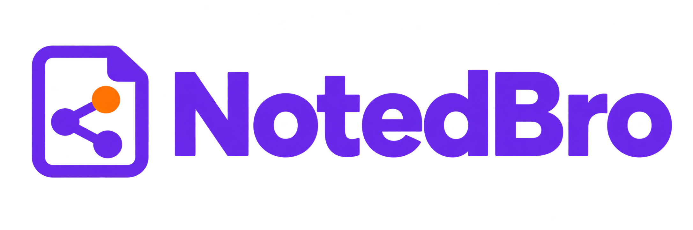
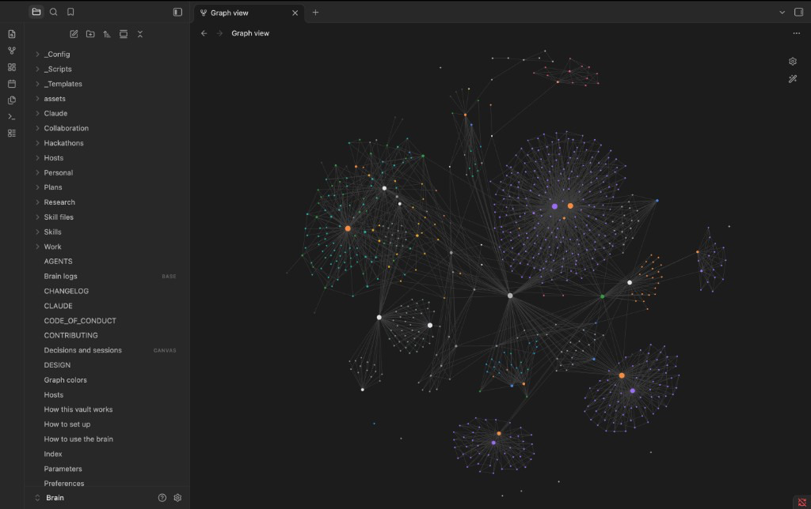

# Notedbro

<p align="center">
  
</p>

Notedbro is a kit for saving useful AI-chat context as small Markdown files. Brain is the folder you create from the kit. A session card records what you asked, what changed, and, when available, where the original transcript lives.

There is no database or Python package to install. Automated setup requires Git, Python 3.9 or later, and a supported local AI tool. Any Markdown editor works; Obsidian adds optional graph and canvas views.

[Setup](How%20to%20set%20up.md) · [Daily use](How%20to%20use%20the%20brain.md) · [Troubleshooting](Troubleshooting.md) · [Migrate from 1.0.0](Migration%201.1.0.md)

## Choose your workflow

| Tool | Access and setup | Saving sessions | Limit |
|---|---|---|---|
| Claude Code | Local project instructions and hook | Automatic at session end | Start Claude at Brain's root |
| Cursor | Local hook plus manually pasted user rule | Automatic on supported hook events | Complete the user-rule step and verify a session |
| Codex | Local access plus marked global instructions | Send `fnsh update` after a change | No automatic filing hook |
| ChatGPT, Claude.ai, Gemini in a browser | Paste/upload relevant context yourself | Ask for a card and save it yourself | No local-file access or connection is installed |

Commands beginning with `fnsh` are messages to your AI chat. They are not Terminal commands. Instructions guide the model; they are not guaranteed persistent memory or a search service. Supply relevant context when starting work elsewhere.

## Quick start

First install the [prerequisites](Prerequisites.md). On GitHub choose **Use this template → Create a new repository**, select **Private**, and name your copy Brain. Clone **your private repository**, using the URL copied from its Code button.

**Terminal — replace YOUR-ACCOUNT with your GitHub account:**

```bash
mkdir -p ~/Documents
git clone https://github.com/YOUR-ACCOUNT/Brain.git ~/Documents/Brain
cd ~/Documents/Brain
python3 _Scripts/setup codex
```

Replace `codex` with `claude`, `cursor`, or `web`. Follow the printed manual steps in the [setup guide](How%20to%20set%20up.md). Existing folder? Use the [migration guide](Migration%201.1.0.md) rather than cloning over it.

**AI chat — after connecting a local tool:**

1. Send `fnsh brain` to check that instructions are loaded.
2. Work on a small task, then send `fnsh update` to save a session card.
3. Send `fnsh check` to check the local files.

Inspect the saved card under `Personal/Chats/Sessions/` before considering setup verified. Browser users follow the separate manual flow.

## Privacy and backups

Private template copies keep origin pointed at your own repository. Notes, the private workspace map, local Claude settings, and backups remain ignored by Git. **A private repository does not back up ignored files.** Make a separate backup; optional encrypted snapshots are described in [Advanced configuration](Advanced%20configuration.md).

Generated `.claude/settings.local.json` stays local. Shared `.claude/settings.json` is preserved. Content scanning helps catch common leaks but cannot guarantee that every sensitive value is detected. Plain Git operations bypass Notedbro's shipping checks.

Local storage does not prevent your AI provider from receiving context that its app reads or that you paste/upload.

## Network behavior

| Operation | Network and data |
|---|---|
| Setup, structural checks, guard, view generation, local migration comparison | No network requests |
| Session filer | Local by default; an explicitly configured Anthropic model sends cleaned user-message excerpts |
| Upgrade check | Requests GitHub release metadata; no notes sent |
| Ship | Git fetch/push and optional GitHub PR creation; branch files and PR text leave the machine after confirmation |
| Maintainer sync | Fetches GitHub repository data |
| Shadow backup | Local encryption; dependency installation may download through Homebrew |

Automatic remote upgrade installation is incomplete in 1.1.0. Use the [manual migration procedure](Migration%201.1.0.md); checking a version does not install it.

## Optional views

<p align="center"></p>

The screenshot shows a customized installation with existing notes and graph colors. Fresh setup generates an empty session/decision canvas. Obsidian graph styling is optional and configured separately.

## More

- [Advanced configuration](Advanced%20configuration.md): projects, preferences, routing, graphs, backups.
- [Maintainer guide](Maintainer%20guide.md): publication, synchronization, release gates.
- [Contributing](CONTRIBUTING.md): developer workflow and tests.
- [Security](SECURITY.md): data handling and vulnerability reporting.
- [Design](DESIGN.md): why summaries are kept separately from transcripts.

macOS is the primary local platform. CI tests the portable workflows on macOS and Linux; scheduled LaunchAgents are macOS-only. Native Windows and WSL are unverified. Actual host integration also requires the smoke checks in the setup guide.
